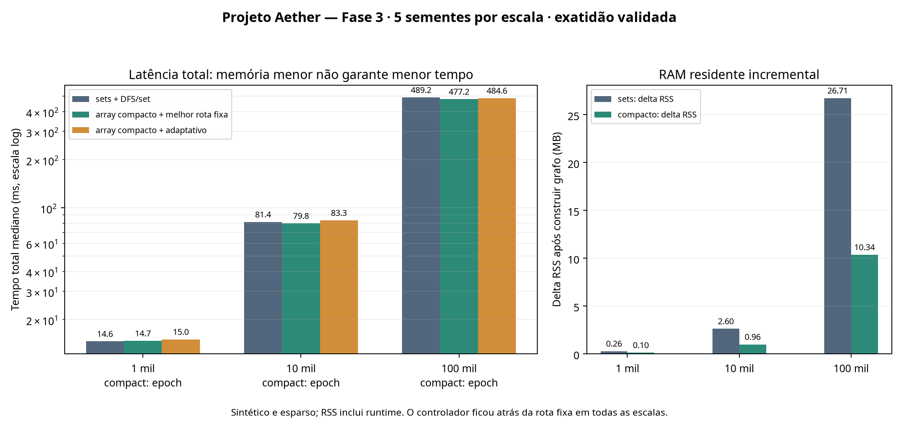

# Aether — Fase 3: escala, mudanças dinâmicas e avaliação de Rust

## Resumo executivo

A Fase 3 implementou e avaliou grafos dirigidos mutáveis em 1 mil, 10 mil e 100 mil nós. As remoções e inserções são exatas: o motor pesquisa a adjacência atual, sem conservar fatos obsoletos de fecho transitivo. A carga foi corrigida para incluir respostas positivas e negativas e sentinelas que demonstram uma relação alcançável antes de uma remoção, inalcançável depois dela e outra relação alcançável após a substituição.

Resultados principais, limitados a esta carga sintética:

- O armazenamento de adjacência por `array('I')` reduziu o heap estimado retido em aproximadamente **62,6–62,8%** contra conjuntos Python. O RSS incremental do grafo caiu aproximadamente **61,3–62,9%**; RSS de processo ainda inclui interpretador, entrada e buffers.
- Essa economia não produziu ganho universal de latência. Em 1 mil nós, `compact+epoch` foi cerca de **0,8% mais lento** que `sets+epoch`; em 10 mil, `compact+epoch` foi cerca de **2,0% mais rápido** que `sets+set`; em 100 mil, `compact+epoch` foi cerca de **0,3% mais lento** que `sets+epoch`. Essas diferenças pequenas são sujeitas a ruído do host compartilhado.
- O controlador aprendeu tempos por rota em consultas reais, recalibrou após alterações e trocou de rota. Mesmo assim, seu total mediano perdeu para a melhor rota fixa em todas as escalas comparáveis. **Não deve ser ativado por padrão.**
- O perfil isolado aponta a DFS Python como gargalo real. Um microbenchmark separado encontrou Rust/CSR aproximadamente **42,5× mais rápido** que uma variante Python com pilha reutilizada, mas mediu somente o kernel de consulta, não o sistema completo.

A conclusão não é “Aether é mais eficiente em geral”. A conclusão é mais restrita: há economia importante de memória com arrays compactos; o melhor algoritmo depende do tamanho e da carga; o controlador atual ainda não paga seu custo; um kernel nativo merece um protótipo de integração controlado, mas os resultados Rust não provam ganho end-to-end.



## Protocolo e carga

Foram executados **75 processos isolados**: três escalas × cinco sementes × cinco combinações de armazenamento/consulta. Cada semente usa a mesma carga determinística para os cinco comparadores. Todas as respostas foram idênticas entre as estratégias e passaram as sentinelas dinâmicas.

O grafo é um DAG esparso dirigido: cadeia mais atalhos forward determinísticos. Consultas largas misturam pares alcançáveis e inalcançáveis. A primeira rajada remove pontes da cadeia e atalhos e insere relações substitutas; consultas locais incluem tanto uma relação inserida quanto uma ponte removida. A segunda rajada substitui novamente arestas e muda relações alcançáveis. Em 100 mil nós, cada semente executa 90 consultas, com 45 respostas positivas e 45 negativas; nas escalas de 1 mil e 10 mil, a contagem mediana também fica equilibrada (152/148 e 90/90, respectivamente).

Comparadores: DFS iterativa com conjuntos Python; DFS com marcas de época sobre conjuntos; os mesmos dois métodos sobre adjacency compacta `array('I')`; e o controlador online sobre `array('I')`. A rota de época evita limpar uma matriz de visitados a cada consulta. Cada processo constrói seu próprio grafo. Os tempos separam construção, atualizações, consultas, total de parede e CPU do processo.

## Resultados principais

Medianas em milissegundos, cinco sementes por estratégia. “Melhor convencional” é a menor entre as implementações não adaptativas; “melhor compacta” é a menor entre `compact+set` e `compact+epoch`. O total inclui construção inicial, updates e consultas. Memória heap é estimativa das estruturas retidas; RSS incremental é o delta residente medido após construir o grafo.

### Auditoria da divergência entre gráfico e tabela

O par 16,104 ms versus 18,972 ms veio do mesmo conjunto histórico `results/phase3/final_mixed/summary.json`, mas **não era a mesma estratégia**: 16,104 ms corresponde a `compact+epoch`, enquanto 18,972 ms corresponde a `compact+set`. O gráfico antigo escolhia a rota compacta fixa mais rápida em cada escala; a tabela antiga mostrava especificamente `compact+set`. Logo, era uma inconsistência de rótulo/definição, não um erro dos dados medidos. Os arquivos históricos foram preservados sem alteração.

Para eliminar a ambiguidade, gráfico e tabela desta revisão usam os mesmos dados de release (`results/phase3/final_release/summary.json`) e identificam a rota compacta vencedora no eixo: em 1 mil nós `compact+epoch` = 14,691 ms e `compact+set` = 14,776 ms; em 10 mil, `compact+epoch` = 79,792 ms; em 100 mil, `compact+epoch` = 477,229 ms. O PNG histórico foi preservado; o script gera por padrão uma figura corrigida separada em `results/phase4/phase3_release_consistent.png`.

| Nós | Consultas por semente | Melhor convencional (total) | Melhor compacta (total) | Controlador compacto (total) | Heap sets → compacto | RSS incremental sets → compacto |
|---:|---:|---:|---:|---:|---:|---:|
| 1.000 | 300 | `sets+epoch`: 14,57 ms | `compact+epoch`: 14,69 ms | 15,02 ms | 280.492 → 104.840 B (−62,6%) | 258.048 → 98.304 B (−61,9%) |
| 10.000 | 180 | `sets+set`: 81,42 ms | `compact+epoch`: 79,79 ms | 83,34 ms | 2.802.292 → 1.045.160 B (−62,7%) | 2.596.864 → 962.560 B (−62,9%) |
| 100.000 | 90 | `sets+epoch`: 475,74 ms | `compact+epoch`: 477,23 ms | 484,57 ms | 27.972.900 → 10.400.968 B (−62,8%) | 26.714.112 → 10.338.304 B (−61,3%) |

Em 100 mil nós, `compact+epoch` ficou **0,3% acima** de `sets+epoch` no total (477,23 contra 475,74 ms): latência efetivamente empatada neste ensaio. A evidência mais forte é de memória: RSS de pico 29.548 KiB para `compact+epoch` contra 45.532 KiB para `sets+epoch` (aproximadamente 35,1% menor, incluindo runtime). Os tempos de build e consulta variam entre processos; não se deve generalizar a diferença de latência.

O controlador teve total 3,1% acima da melhor rota fixa em 1 mil nós, 4,5% acima em 10 mil e 1,9% acima em 100 mil. Houve trocas observadas (mediana de 3, 4 e 3, respectivamente), mas a exploração/calibração não superou a rota fixa mais rápida. É um resultado negativo; não ativar o seletor por padrão.

### Correção

Nos 75 processos, as sequências de respostas concordaram exatamente entre os cinco métodos. O harness exige, para cada semente, que a sentinela da ponte seja verdadeira antes da remoção, falsa depois e que a aresta de substituição seja alcançável depois da segunda mudança. Cada carga também deve conter pelo menos uma resposta positiva e uma negativa. Testes unitários adicionais cobrem 500 operações aleatórias de adicionar/remover por backend contra um oráculo independente de alcançabilidade, remoção de aresta ausente, duplicatas, IDs inválidos e recalibração do controlador.

## CPU, FLOPs, energia e dados

A medição de CPU é `process_time` do processo; não é contagem de instruções. FLOPs não são uma métrica útil para esta travessia de grafo inteira e **não foram inventados**. Não havia medidor de energia, portanto joules não foram estimados. “Dados” são nós e relações sintéticas do grafo, não exemplos de treinamento de um sistema geral; a fase não demonstra aprendizado de conhecimento aberto.

O RSS é o residente do processo completo. A estimativa de heap retido contabiliza os contêineres e objetos de vizinhos, não o armazenamento serializado em disco. A representação compacta é uma sequência de arrays por nó, não CSR, e suporta IDs sem sinal de 32 bits.

## Perfil e avaliação de Rust

Um `cProfile` separado de 100 mil nós contou 11.005.286 chamadas. A DFS iterativa `reachable_epoch` somou 1,576 s de tempo cumulativo de perfil em 1,873 s totais (84,1%); o tempo próprio foi 1,058 s. As operações mais visíveis em seguida foram `pop`, `append` e acesso a vizinhos. O perfil é instrumentado e serve para localizar gargalos; seus tempos não são comparáveis às latências sem profiler da tabela.

Depois desse diagnóstico, foi compilado `rust_dfs_kernel.rs` com `rustc -O` e comparado em cinco sementes sobre o snapshot final de cada grafo de 100 mil nós. Foram cronometradas dez repetições de 30 consultas por semente. Todas as 300 respostas por semente coincidiram com as duas variantes Python.

| Kernel (10 × 30 consultas/seed) | Mediana | Comparação |
|---|---:|---:|
| API Python atual (`reachable_epoch`) | 1.521,89 ms | 41,8× o tempo Rust |
| Python com pilha reutilizada | 1.537,47 ms | 42,5× o tempo Rust |
| Rust `-O`, CSR + marcas/stack reutilizados | 36,43 ms | referência do microbenchmark |

Isto **não é uma comparação end-to-end**: os intervalos excluem geração do grafo, updates, serialização, início do processo Rust, parsing e construção do CSR. O Rust usa layout contíguo CSR e stack reutilizada; a variante Python otimizada reutiliza stack, mas percorre arrays por linha. O protótipo Rust ainda não tem interface de produção, updates dinâmicos nem controlador. Assim, o perfil justifica avaliar um núcleo nativo para DFS de alcançabilidade; o próximo teste necessário é integrá-lo sem mudar semântica e medir o sistema completo, incluindo conversões, updates, memória e cargas pequenas. Não se deve multiplicar o throughput total do Aether por 37×.

## Limitações

- Cinco sementes por ponto e dados sintéticos; não representam tráfego de aplicações ou grafos reais.
- O caso de 100 mil nós usa grafo esparso com cerca de 199 mil arestas e 90 consultas por semente; não cobre grafos densos, distribuições de alto grau, consultas adversariais ou carga concorrente.
- As remoções são corretas porque cada busca consulta a adjacência atual; não há índice de fecho dinâmico que atualize incrementalmente relações após deleções.
- O controlador ajusta somente a travessia de consulta; não escolhe backend de armazenamento e não é vencedor nesta avaliação.
- CPU wall, heap estimado e RSS têm limitações; energia e consumo em disco não foram medidos.
- O kernel Rust é microbenchmark, não implementação completa da arquitetura.

## Reprodução e arquivos brutos

```bash
cd Aether
python3 -m unittest -v test_aether_dynamic.py test_aether_engine.py
python3 phase3_bench.py --seeds 5 --out results/phase3/final_release
python3 rust_kernel_eval.py --seeds 5 --n 100000 --queries 90 --repetitions 10 --out results/phase3/rust_release
```

Os arquivos `runs.csv` preservam cada execução; `summary.json` contém medianas e metadados. As pastas `smoke`, `final`, `final_online` e `final_mixed` são execuções exploratórias anteriores, preservadas por rastreabilidade; a bateria reproduzida após a correção dos rótulos está em `final_release`.

## Conclusão da Fase 3

**Promissor em economia de memória para grafos esparsos; não promissor como seletor adaptativo atual; latência total quase empatada com convencionais em 100 mil nós.** A redução de aproximadamente 63% no heap estimado é mensurável, mas vem com perda de tempo em 1 mil nós e ganhos modestos ou ausentes nas outras escalas. O kernel Rust apresenta uma oportunidade forte e localizada, porém ainda precisa passar por integração e benchmark end-to-end antes de qualquer alegação de eficiência do sistema.
