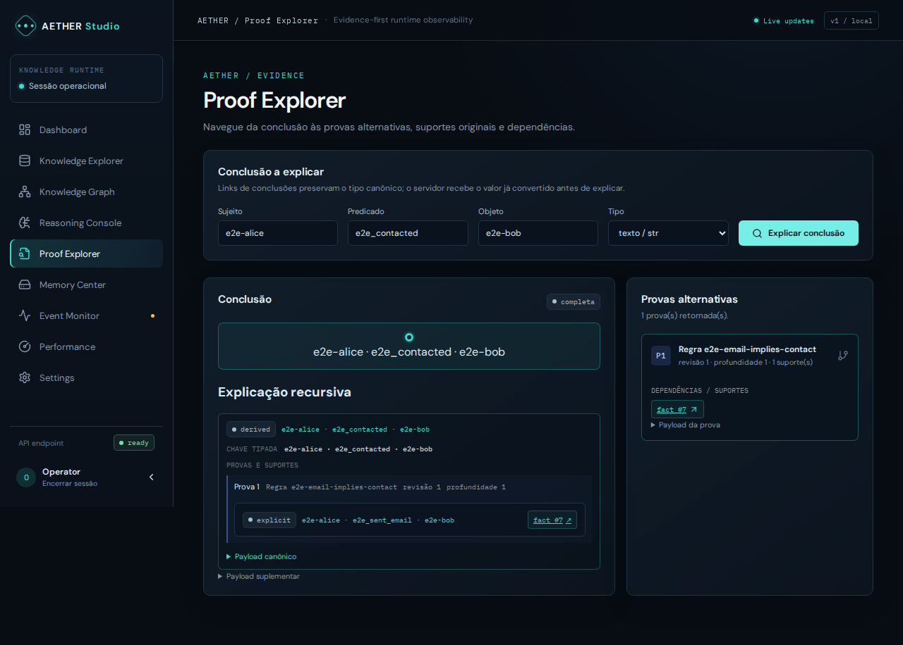

# AETHER — grafos dinâmicos e raciocínio relacional experimental

AETHER reúne protótipos de grafos mutáveis e raciocínio simbólico sobre fatos relacionais estruturados. Não é um sistema de inteligência geral nem afirma compreender linguagem natural. Os resultados são experimentais e cada relatório registra workloads, limitações e condições de reprodução.

## Estado e arquitetura

A branch `main` contém o histórico da Phase 7new; os relatórios de fases são registros históricos separados, não alegações atuais. Consulte [`docs/phases/PHASE7NEW_REPORT.md`](docs/phases/PHASE7NEW_REPORT.md) para o estado histórico anterior e [`docs/architecture/OVERVIEW.md`](docs/architecture/OVERVIEW.md) para a arquitetura organizada.

O código instalável está em `src/aether/`: `core/` guarda conhecimento estruturado; `reasoning/` agrupa inferência forward/backward/híbrida e dependências; `graph/` contém grafos, componentes e indexação; `memory/` abriga cache e políticas; `temporal/` contém eventos/checkpoints; `native/` mantém bindings Python e fonte Rust; `adapters/` integra dados SNAP. Harnesses ficam em `benchmarks/`, testes em `tests/`, manifestos em `datasets/manifests/`, resultados históricos em `results/` e documentação em `docs/`. O [mapeamento de módulos](docs/architecture/MODULES.md) e o [grafo de dependências](docs/architecture/DEPENDENCIES.md) detalham as fronteiras.

## Instalação

Requer Python 3.10 ou superior. O backend Rust é opcional para a instalação Python e exige Rust 1.99.1 e linker compatível para compilar a biblioteca nativa local. Instalação editável:

```bash
python -m venv .venv
python -m pip install --upgrade pip
python -m pip install -e .
python -c "import aether; print(aether.__version__)"
```

Veja o [setup geral](docs/development/SETUP.md), as instruções específicas para [Windows](docs/development/SETUP_WINDOWS.md) e [Linux](docs/development/SETUP_LINUX.md). O wrapper seleciona `.dll`, `.so` ou `.dylib` no host atual e valida a ABI; não reutilize binários nativos de outro sistema ou arquitetura. Para compilar explicitamente:

```bash
python -c "from aether.native.bindings import compile_native; print(compile_native())"
```

A API moderna pode ser importada de `aether`; os imports flat antigos como `aether_knowledge` permanecem temporariamente como aliases. Exemplo:

```python
from aether import DynamicGraph, KnowledgeStore

store = KnowledgeStore()
graph = DynamicGraph(3)
graph.add_edge(0, 1)
```

## Testes

```bash
python -m unittest discover -s tests -v
python -m unittest discover -s tests/portability -v
```

Consulte o [guia de testes](docs/development/TESTING.md). A compatibilidade de plataforma deve ser julgada somente pelos resultados da CI registrados para a branch/commit em questão. Consulte [suporte por plataforma](docs/architecture/PLATFORM_SUPPORT.md); Linux ARM64 só será declarado suportado após execução real em runner apropriado.

## Benchmarks e datasets

O benchmark básico pode ser iniciado com `python aether_bench.py` (entrypoint flat de compatibilidade) ou `python -m benchmarks.baseline.aether_bench`. Para benchmarks por fase, use os módulos em `benchmarks/phase2/` até `benchmarks/phase8/`; comandos históricos na raiz são wrappers temporários. Antes de uma execução completa, valide parâmetros pequenos e use um novo caminho `--out`. Os scripts se recusam a sobrescrever diretórios de saída já preenchidos.

Dados SNAP grandes não são incluídos no pacote. O manifesto canônico está em [`datasets/manifests/phase5_datasets.json`](datasets/manifests/phase5_datasets.json); confira condições de uso e hashes antes do download. Consulte o [guia de benchmarks](docs/development/BENCHMARKS.md). Métricas sem suporte confiável são registradas como `null`, nunca inventadas como zero. Não compare proxies de operações entre algoritmos como FLOPs.

## Histórico preservado

Os relatórios, auditorias e procedimentos históricos foram movidos sem apagar seu conteúdo: [fases](docs/phases/), [auditorias](docs/audits/) e [decisões arquiteturais](docs/decisions/). Artefatos históricos das fases 2 a 8 ficam em `results/`; os valores e a proveniência anteriores à reorganização foram preservados, incluindo os resultados da Phase 8 integrados ao `main`. O código de benchmark da Phase 8 está em `benchmarks/phase8/`, e seus relatórios em `docs/phases/`. O arquivo original da primeira versão permanece em `archive/v1/`.

## Licença e segurança

O código é distribuído sob MIT (consulte `LICENSE`). Para reporte responsável de vulnerabilidades, consulte `SECURITY.md`.

## AETHER Studio — evolução da plataforma

A branch `evolution/aether-platform` acrescenta evidências múltiplas e paginação, snapshots semânticos verificáveis, cold tier SQLite, padrões globalmente limitados, Event Engine durável, planejamento seletivo medido e a camada independente FastAPI + React/TypeScript/Vite. As branches históricas e seus resultados permanecem preservados; esta entrega não faz merge automático em `main`.

```bash
python -m pip install -e ".[api]"
pnpm --dir frontend install --frozen-lockfile
python scripts/run_studio.py
```

Abra `http://localhost:3000`. API/Studio exigem autenticação: token de operador configurado no servidor na instalação independente, ou Manus OAuth no ambiente gerenciado. Operadores OAuth são explicitamente autorizados; identidade autenticada não basta para escrever. Não há segredos embutidos no cliente. Dados locais ficam em `.aether-data/`, ignorados por Git. O launcher encerra ambos os processos no Ctrl+C e admite `--api-only`/`--frontend-only`. Detalhes no [guia Studio](docs/development/WEB_STUDIO.md), [API](docs/architecture/API.md), [plataforma](docs/architecture/PLATFORM.md) e nos setups Windows/Linux.

Dashboard, exploração/CRUD de conhecimento, grafo, consultas, provas, memória, eventos, desempenho e configurações usam o núcleo real. Métricas indisponíveis são `null`/“indisponível”; resultados incompletos continuam explícitos; frequência operacional nunca é tratada como verdade semântica. O Event Engine entrega at-least-once e não promete exactly-once.

### Validação e medições

```bash
python -m unittest discover -s tests -v
pnpm --dir frontend typecheck
pnpm --dir frontend test
pnpm --dir frontend build
```

O [relatório de eficiência](docs/architecture/EFFICIENCY.md) registra ganho de 1,626× do join seletivo no holdout seletivo e empate no balanceado. O controller adaptativo manteve equivalência em 2.400 consultas, mas perdeu das fixas em nove famílias: permanece opt-in, não é estratégia padrão da API. O ciclo Rust de grafos, incluindo build/FFI/atualização/recuperação, ganhou 3,694× no esparso e 1,561× no denso em holdout; isso não é uma alegação de ganho de inferência simbólica. Os [benchmarks operacionais](docs/architecture/OPERATIONAL_BENCHMARKS.md) medem memória/eventos/snapshots com 30 seeds por família. Dados e hashes estão em `results/evolution/`, sem sobrescrever resultados antigos. Energia não foi medida.

O pipeline de API/Studio foi medido novamente com 20 seeds de calibração e 10 de holdout, oráculo correto nos 30; o [relatório do benchmark API](docs/architecture/API_BENCHMARK.md) registra o custo total e suas limitações. Capturas reais da sessão browser E2E, incluindo prova com suporte e grafo, estão na [galeria do Studio](docs/development/STUDIO_SCREENSHOTS.md). A fixture e a sessão dessas imagens são efêmeras, não dados de produção.

Resultados por SO, capturas reais, testes e pendências são registrados no [relatório de evolução por fase](docs/development/EVOLUTION_REPORT.md). Linux ARM64 é a validação local desta sessão; Windows/Linux x86_64 dependem de resultados efetivos da CI. Não confunda instruções/matriz configurada com aprovação de execução, nem Preview com publicação pública.



As imagens vêm de execução autenticada em store local descartável; veja a [galeria completa das telas, incluindo navegação móvel](docs/development/STUDIO_SCREENSHOTS.md). Não são capturas de dados de produção.
