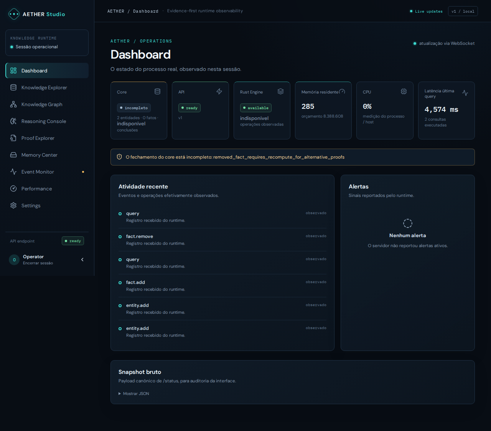
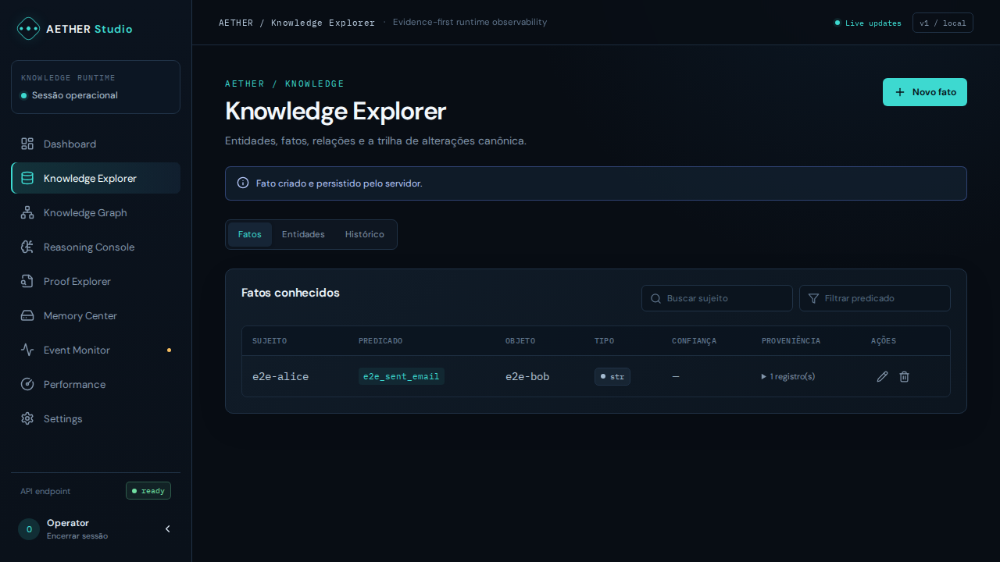
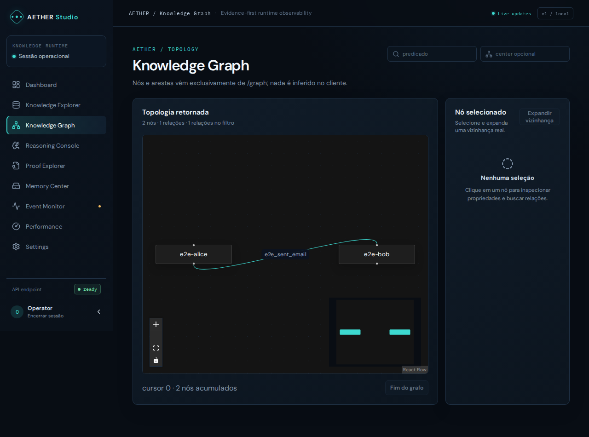
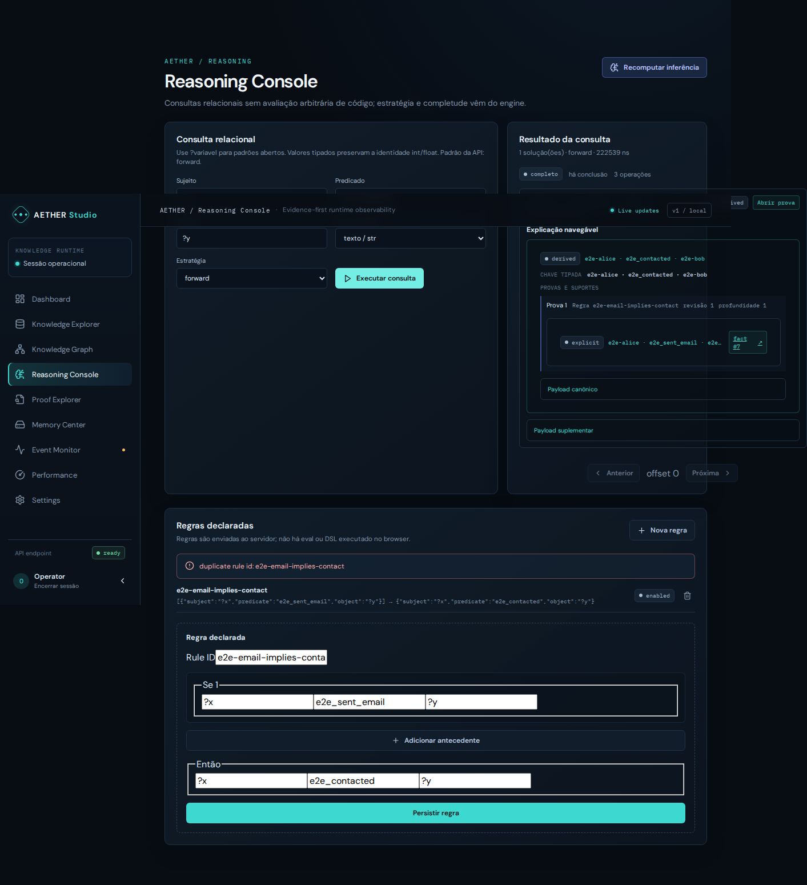
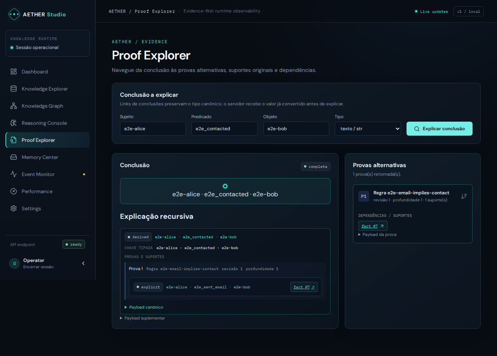

# Capturas reais do AETHER Studio

As capturas abaixo vieram do Playwright/Chromium contra a aplicação React/Vite e a API FastAPI locais, com sessão operador temporária e store descartável. A primeira metade usa entidades/fatos/regras efetivamente criados pela UI durante o cenário E2E; o teste remove seu fato de suporte antes de encerrar. As demais páginas mostram o estado real retornado pelo mesmo runtime. Não são screenshots de mockup nem de dados de produção.

## Telas integradas

## Operação e responsividade

| Página | Captura |
|---|---|
| Memory Center | [Abrir PNG](../screenshots/studio/memory.png) |
| Event Monitor | [Abrir PNG](../screenshots/studio/events.png) |
| Performance Monitor | [Abrir PNG](../screenshots/studio/performance.png) |
| Settings | [Abrir PNG](../screenshots/studio/settings.png) |
| Navegação móvel (390 px) | [Abrir PNG](../screenshots/studio/mobile-menu.png) |

O Dashboard captura a condição pós-remoção em que o motor declara que precisa recomputar provas alternativas: o indicador `incomplete` é intencional e demonstra que o Studio não mascara como pronta uma conclusão obsoleta. Os dados são descartáveis e o cenário não altera dados de usuário/produção.
