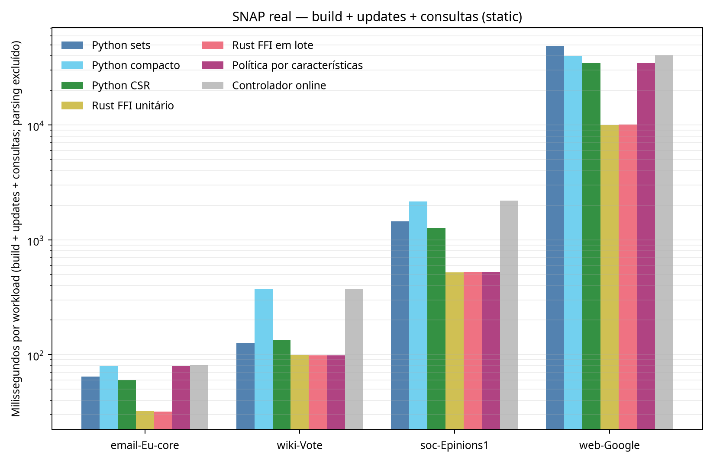
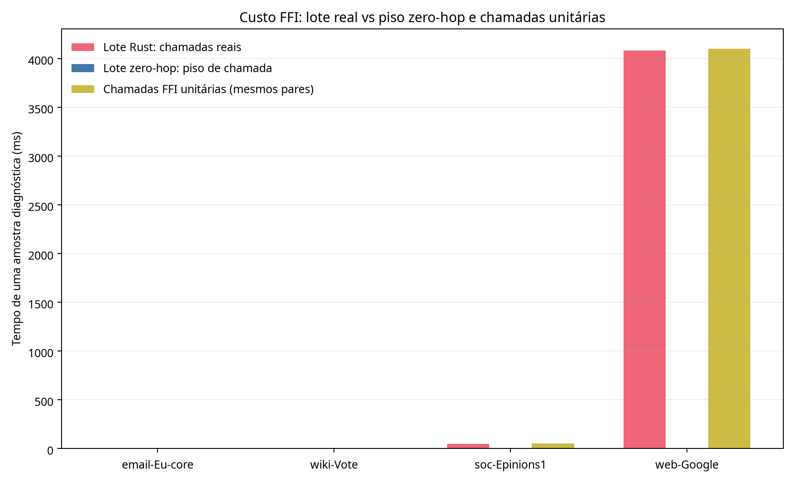
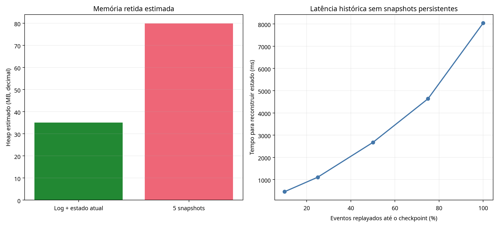

# AETHER — Fase 5: validação real, FFI em lote e expansão controlada

## Resultado principal

A Fase 5 transformou a integração Python–Rust em uma evolução testada do protótipo, sem declarar uma vantagem geral. O núcleo agora possui ABI v2 verificada, carregamento nativo dependente da plataforma, inserções/remoções/consultas em lote, buffer de saída reutilizável e proteção de erros na fronteira FFI. A bateria completa passou em **47 testes unitários** e todas as execuções experimentais foram conferidas contra oráculos independentes.

A evidência mais forte veio dos quatro grafos SNAP reais. Foram executados **240 benchmarks** em processos isolados: quatro datasets, modos estático/dinâmico quando aplicável, três seeds, duas repetições e métodos fixos, FFI unitário, FFI em lote, política por características e controlador online. As respostas de alcançabilidade, caminhos mínimos, vizinhanças e cache coincidiram com validações independentes; nenhuma execução apresentou divergência.

Em `web-Google`, a mediana do workload foi de **10.130,8 ms** para Rust FFI em lote, contra **34.623,6 ms** para Python CSR e **48.806,5 ms** para Python sets. Em `soc-Epinions1`, Rust FFI unitário foi a melhor rota medida, com **522,3 ms**, e o lote ficou em **524,5 ms**. Em grafos pequenos, o lote ajudou, mas a fronteira de processo ainda pesa no end-to-end.



## Ambiente e reprodução

A execução oficial ocorreu em Ubuntu 24.04.5 LTS, Linux `aarch64`, Python 3.12.3, Rust 1.99.1, seis CPUs lógicas e aproximadamente 25,6 GB de RAM visível. A Fase 4 histórica foi executada em AMD EPYC `x86_64`; suas latências não são diretamente comparáveis às da Fase 5. A diferença de arquitetura e host é uma limitação, não um detalhe a ser normalizado por cálculo.

```bash
cd Aether
source "$HOME/.cargo/env"
python3 -m unittest discover -v
python3 phase5_bench.py --out results/phase5/real_data --seeds 3 --repeats 2 --queries 1000 --batch-size 8
python3 phase5_temporal_bench.py --out results/phase5/temporal_history
python3 phase5_components_bench.py --out results/phase5/components --repeats 3
python3 phase5_synthetic_bench.py --out results/phase5/synthetic_30seeds --seeds 30 --queries 100
python3 phase5_plot.py
```

A matriz real recusará sobrescrever uma pasta preenchida. Os dados brutos, hashes e resumos estão em `results/phase5/`; os arquivos SNAP não são versionados. O procedimento de Windows está documentado em [`PHASE5_INSTALL.md`](../development/PHASE5_INSTALL.md), mas Windows 10/11 não foi executado nesta tarefa e, portanto, não é declarado como compatibilidade validada.

## Dados SNAP e procedência

Foram baixados localmente quatro grafos estáticos — `email-Eu-core`, `wiki-Vote`, `soc-Epinions1` e `web-Google` — e o temporal `sx-askubuntu`. As páginas oficiais publicam, respectivamente, 1.005/25.571, 7.115/103.689, 75.879/508.837 e 875.713/5.105.039 nós/arestas. Os arquivos estáticos foram mantidos dirigidos; não houve espelhamento de arestas. O temporal preservou todos os 964.437 eventos, inclusive repetições, e terminou com 596.933 relações dirigidas únicas.

Os hashes SHA-256 e as contagens observadas estão em [`phase5_datasets.json`](../../datasets/manifests/phase5_datasets.json) e no resumo do benchmark. `gzip -t` passou nos cinco arquivos. Nenhum dataset foi incluído no Git. As fontes oficiais consultadas não apresentaram licença específica dos dados; a BSD encontrada é do software SNAP e não foi atribuída aos arquivos. Essa distinção está documentada em [`PHASE5_SNAP_RESEARCH.md`](PHASE5_SNAP_RESEARCH.md). [1] [2] [3] [4] [5] [6]

## Benchmark SNAP real

Cada workload usou a mesma sequência determinística de consultas e updates para todos os métodos comparáveis. A preparação mistura consultas positivas e negativas. Nos modos dinâmicos, há duas rodadas de inserções de arestas ausentes e remoções de arestas presentes, com consultas antes e depois das mudanças. A ordem dos métodos foi rotacionada por seed e repetição. Construção, updates, consultas, CPU, RSS, memória retida, startup end-to-end e preparação foram registrados separadamente.

| Dataset e modo | Melhor método medido | Workload mediano | Python de referência | Observação |
|---|---|---:|---:|---|
| email-Eu-core estático | Rust FFI em lote | 31,85 ms | CSR: 60,00 ms | Lote reduziu o custo por par frente ao FFI unitário |
| email-Eu-core dinâmico | Rust FFI em lote | 36,73 ms | Python sets: 116,97 ms | Updates e consultas permaneceram exatos |
| wiki-Vote estático | Rust FFI em lote | 98,09 ms | Python sets: 125,56 ms | Política escolheu Rust efetivo |
| wiki-Vote dinâmico | Rust FFI em lote | 104,23 ms | Python sets: 191,89 ms | Controlador online ficou em 467,93 ms |
| soc-Epinions1 estático | Rust FFI unitário | 522,33 ms | CSR: 1.272,98 ms | Lote: 524,50 ms; empate prático |
| web-Google estático | Rust FFI unitário | 10.033,58 ms | CSR: 34.623,59 ms | Lote: 10.130,80 ms |

Os números são medianas de seis execuções por grupo, não seis datasets independentes. O end-to-end inclui inicialização do worker e a fronteira do processo, mas exclui o oráculo BFS. Em grafos pequenos, essa fronteira reduz a vantagem observada no kernel. Em `web-Google`, a mesma medição end-to-end foi 63.912,1 ms para FFI unitário contra 87.810,6 ms para CSR e 109.351,6 ms para Python sets.

As diferenças RSS negativas em alguns workers não são interpretadas como economia física de memória: são deltas de processos isolados sujeitos a reutilização do alocador e amostragem do residente. O relatório preserva esses valores no CSV, mas a conclusão de memória usa principalmente estimativas de estruturas retidas e picos de processo, não um delta negativo como evidência de liberação.



## FFI em lote

A API Rust v2 exporta importação em lote, `add_edges`, `remove_edges` e `reachable_many`. O wrapper Python valida tamanho, ponteiros, IDs, paridade dos buffers, overflow de contagem e estado fechado antes de chamar a biblioteca. A biblioteca Rust retorna códigos de erro explícitos e envolve operações recuperáveis para que panic não atravesse a fronteira. O handle serializa chamadas no mesmo objeto; o wrapper não promete paralelismo interno.

No workload real, o lote foi consistentemente melhor ou praticamente empatado com chamadas unitárias. Em `email-Eu-core` estático, o custo médio medido por par foi 0,003094 ms no lote contra 0,003536 ms unitário. Em `wiki-Vote` estático, foi 0,004006 ms contra 0,004395 ms. Em `soc-Epinions1`, o lote ficou ligeiramente acima do unitário no workload total. A decomposição de FFI é diagnóstica: o “zero-hop” ainda valida e percorre pares, portanto a diferença real menos zero-hop é apenas uma estimativa do processamento adicional do grafo, não isolamento puro de transferência.

## Redes sintéticas: 30 seeds independentes

Foram executadas **480 execuções** em quatro cenários, com 30 grafos gerados independentemente por cenário e a mesma carga por método dentro de cada seed. Os cenários foram: esparso estático de 1.000 nós/4.000 arestas; denso desconectado de 1.000/20.000; desconectado dinâmico de 10.000/30.000; e esparso estático de 100.000/300.000. Todas as respostas passaram o BFS independente.

| Cenário | Python de referência | Rust em lote | Exatidão |
|---|---:|---:|---:|
| esparso estático 1k | 8,53 ms | 3,85 ms | 30/30 seeds |
| denso desconectado 1k | 23,43 ms | 14,13 ms | 30/30 seeds |
| desconectado dinâmico 10k | 59,57 ms | 22,96 ms | 30/30 seeds |
| esparso estático 100k | 1.109,79 ms (compacto) | 297,03 ms | 30/30 seeds |

Esses resultados isolam famílias estruturais e não substituem os SNAP reais. Nos cenários sintéticos de 1k, RSS de sets foi maior que o compacto, enquanto em Rust o estado retido permaneceu menor que as estruturas Python correspondentes. O CSV conserva cada seed e cada hash de grafo/workload.

## Referência NetworkX

Foi executado um comparador funcional NetworkX em ambiente virtual separado, sem adicionar a biblioteca às dependências do AETHER. Ele usa `DiGraph` e `has_path`, cuja documentação define o teste de existência de caminho dirigido. [7] Foram feitas 15 execuções em `email-Eu-core`, `wiki-Vote` e `soc-Epinions1`, nos modos estático e dinâmico quando aplicável. Todos os hashes de workload coincidiram com o benchmark principal e todas as respostas coincidiram com BFS independente.

As medianas NetworkX/Rust FFI em lote foram 75,69/31,85 ms para `email-Eu-core` estático, 93,11/36,73 ms no dinâmico, 234,25/98,09 ms para `wiki-Vote` estático, 255,66/104,23 ms no dinâmico e 1.604,50/524,50 ms para `soc-Epinions1` estático. Isso é uma referência funcional em Python, não uma prova de superioridade geral: NetworkX e AETHER têm representações, objetivos e custos de construção diferentes, e `web-Google` foi omitido desse comparador por custo de memória/tempo do grafo de objetos Python.

## Histórico temporal

O protótipo temporal usa arrays paralelos para timestamp, origem, destino e operação, mantendo um único grafo atual. Estados anteriores são reconstruídos por replay sob demanda; snapshots históricos não são retidos pelo protótipo. No `sx-askubuntu`, a ingestão completa levou 9.157,6 ms, o parsing 2.055,3 ms, a ordenação 313,8 ms e o end-to-end parse+sort+ingest 33.917,3 ms.

O log mais o estado atual foi estimado em 35,1 MB, contra 79,9 MB para cinco snapshots materializados simultaneamente, uma razão de 0,439. A reconstrução mediana nos cinco checkpoints foi 2.671,8 ms e o máximo observado foi 8.042,5 ms. Não há P95: cinco checkpoints não sustentam essa inferência. O estado reconstruído coincidiu com replay independente em todos os pontos.



O custo é explícito: replay sem checkpoints cresce com a quantidade de eventos anteriores. A próxima evolução deve avaliar checkpoints seletivos ou índices temporais sem voltar a armazenar uma cópia completa para cada evento.

## Novas capacidades

Foram adicionadas e testadas as seguintes capacidades sobre a adjacência existente:

- vizinhança limitada a dois saltos, com deduplicação e exclusão do nó inicial;
- menor caminho não ponderado com reconstrução do caminho;
- cache LRU experimental com limite de capacidade/memória e invalidação após mutação efetiva;
- componentes fracamente conectados por union-find com compressão de caminho e união por rank.

O benchmark real validou caminhos, vizinhanças e cache contra BFS independente em todos os grupos aplicáveis. O cache foi medido separadamente para não contaminar os percentis do workload principal. Em `email-Eu-core` estático, a mediana da economia de duas passagens cacheadas foi aproximadamente 48%, mas uma mutação efetiva invalida o resultado. O cache é experimental e não é ativado automaticamente.

A medição de componentes executou oito combinações dataset/backend, três repetições por combinação, e todas foram exatas. O número de componentes fracos foi 20 em `email-Eu-core`, 24 em `wiki-Vote`, 2 em `soc-Epinions1` e 2.746 em `web-Google`. A definição trata cada arco dirigido como conexão não dirigida; isso não é detecção de componentes fortemente conectados. O algoritmo é recomputado do zero após mudanças; não existe manutenção incremental de componentes afetados.

## Comparação entre Fases 3, 4 e 5

A Fase 3 mostrou economia de aproximadamente 63% no heap estimado da adjacência compacta em grafos sintéticos, mas latência quase empatada e controlador pior que rotas fixas. A Fase 4 integrou Rust FFI e observou reduções end-to-end importantes em cargas sintéticas, chegando a aproximadamente 74% de redução de workload em 1 milhão de nós, mas ainda sem dados reais e com chamadas individuais.

A Fase 5 confirmou em SNAP real que a vantagem de Rust pode sobreviver à construção, updates e consultas, especialmente a partir de `soc-Epinions1` e `web-Google`. Também mostrou que o FFI em lote reduz overhead em vários cenários, mas não vence sempre o unitário. A política por características permaneceu experimental: em alguns casos escolheu CSR e ficou próxima do melhor, mas a decisão não demonstrou superioridade universal. O controlador online continuou mais lento que a melhor rota fixa nos grupos em que foi medido.

A diferença central da Fase 5 não é um número máximo de aceleração. É a combinação de procedência real, hashes, workloads comuns, validação independente, API nativa com erros explícitos, capacidades adicionais e limites documentados.

## O que é medido, estimado, experimental ou ausente

**Medido:** tempos de construção, updates, consultas, workload, CPU, startup end-to-end, p50/p95/p99 quando a amostra permite, RSS amostrado, pico de RSS, hashes, contagens SNAP, exatidão, replay temporal e componentes.

**Estimado:** memória retida por `memory_bytes`, workspace do union-find e decomposição do custo FFI zero-hop. Essas métricas são úteis para comparação interna, mas não são equivalentes a RSS ou tempo puro de transferência.

**Implementado e testado:** ABI v2 multiplataforma no código, FFI individual e em lote, buffers reutilizáveis, caminhos, vizinhança, cache versionado, replay temporal e componentes fracos.

**Experimental:** política de representação, controlador online, cache LRU, histórico temporal sem checkpoints persistentes e manutenção de componentes somente por recomputação.

**Não validado nesta tarefa:** execução real em Windows 10/11, energia em joules, FLOPs, concorrência de múltiplos handles, armazenamento persistente de snapshots, componentes fortemente conectados e manutenção incremental de componentes após deleções.

## Limitações e Fase 6

Os datasets reais continuam sendo apenas cinco fontes SNAP e representam redes específicas, não uma distribuição geral de grafos. As seeds sobre o mesmo dataset não são datasets independentes. RSS em processos curtos é ruidoso e não deve ser interpretado a partir de deltas negativos. O temporal usado contém eventos de interação, não remoções observadas; remoções foram testadas apenas em fixtures do protótipo. A compatibilidade Windows permanece uma hipótese de código e procedimento, não um resultado medido.

A Fase 6 deve priorizar: validar Windows 10/11 em hardware real; medir energia com hardware instrumentado; introduzir checkpoints temporais seletivos; avaliar componentes incrementais sob inserções e remoções; testar múltiplos handles concorrentes sem compartilhar estado inseguro; e comparar com uma biblioteca nativa especializada sob um protocolo comum. A política adaptativa só deve virar padrão se vencer rotas fixas em workloads não vistos e pagar explicitamente seu custo de decisão.

## Artefatos

- Benchmark SNAP: [`runs.csv`](../../results/phase5/real_data/runs.csv) e [`summary.json`](../../results/phase5/real_data/summary.json).
- Benchmark sintético: [`runs.csv`](../../results/phase5/synthetic_30seeds/runs.csv) e [`summary.json`](../../results/phase5/synthetic_30seeds/summary.json).
- Componentes: [`components.csv`](../../results/phase5/components/components.csv) e [`summary.json`](../../results/phase5/components/summary.json).
- Referência NetworkX: [`runs.csv`](../../results/phase5/networkx_reference/runs.csv) e [`summary.json`](../../results/phase5/networkx_reference/summary.json).
- Temporal: [`summary.json`](../../results/phase5/temporal_history/summary.json) e [`temporal_checkpoints.csv`](../../results/phase5/temporal_history/temporal_checkpoints.csv).
- Gráficos: [`results/phase5/plots/`](../../results/phase5/plots/).
- Instalação e compilação: [`PHASE5_INSTALL.md`](../development/PHASE5_INSTALL.md).
- Procedência SNAP: [`PHASE5_SNAP_RESEARCH.md`](PHASE5_SNAP_RESEARCH.md).

## Referências

[1]: https://snap.stanford.edu/data/index.html "Stanford Large Network Dataset Collection"
[2]: https://snap.stanford.edu/data/email-Eu-core.html "SNAP email-Eu-core network"
[3]: https://snap.stanford.edu/data/wiki-Vote.html "SNAP Wikipedia vote network"
[4]: https://snap.stanford.edu/data/soc-Epinions1.html "SNAP Epinions social network"
[5]: https://snap.stanford.edu/data/web-Google.html "SNAP Google web graph"
[6]: https://snap.stanford.edu/data/sx-askubuntu.html "SNAP temporal Ask Ubuntu network"
[7]: https://networkx.org/documentation/stable/reference/algorithms/generated/networkx.algorithms.shortest_paths.generic.has_path.html "NetworkX has_path API"
